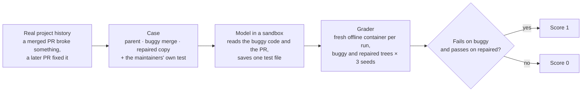

<h1 align="center">RevertBench</h1>

<p align="center">
  <strong>Can an AI write a test that catches a real bug, or does its test just pass?</strong>
</p>

<p align="center">
  <a href="https://github.com/BishalJena/revertbench/actions/workflows/ci.yml"></a>
  
  <a href="cases/README.md"></a>
</p>

RevertBench is a benchmark built from real bugs in open-source Python projects.
Each case is a pull request that was merged with its tests passing, broke
something, and was fixed later. A model gets the buggy code and the pull
request, and must write a test that exposes the bug. The grader runs that test
on the buggy code and on a repaired copy. It earns credit only if it fails on the
first and passes on the second.

## Why this matters

Coding models are increasingly asked to write tests. The usual signs that a
test is good can all be present while the test misses the bug:

- the test exists and runs;
- it passes;
- it calls the code that changed;
- the model says it found the problem.

RevertBench replaces those signs with one check. It runs the test on the real
history: the buggy version and a fixed version of the same code.

## How it works



Each case is checked before it is accepted. The maintainers' original test must
pass on the parent commit, fail on the buggy merge and pass on the repaired copy,
three times each. The repaired copy is the buggy tree plus only the production
fix, so the test cannot be credited for detecting unrelated changes.

A submitted test scores 1 only when all five conditions hold:

| Condition | What it rules out |
| --- | --- |
| Fails on the buggy tree, in its call phase, with an assertion or an exception raised in changed code | Import errors, missing names, setup failures, timeouts |
| Passes on the repaired tree, with exactly the same collected tests | Tests that always fail, skips, xfails, changed collection |
| Executes changed lines itself, measured per test | Coverage borrowed from another test or a fixture |
| Clears the static submission policy before it runs | Reading source, reflection, file/network/process access, naming the fix |
| Gives identical results across three seeded repeats | Flaky and order-dependent tests |

Infrastructure failures, such as a missing image or a lost worker, have no score.
They are never counted as model failures.

## A real example

[more-itertools PR #1079](https://github.com/more-itertools/more-itertools/pull/1079)
tidied up `product_index()`. It merged on Oct 9, 2025, and all 690 existing
tests in the configured suite passed. One line checked the length of the
original input instead of the copied tuple:

```python
# PR #1079, as merged: iterators have no len(), so this raises TypeError
if len(element) != len(args):

# PR #1082, merged 20 hours later
if len(elements) != len(pools):
```

The fix PR added the test "that would have caught the error". In a development
pilot, `gpt-oss-120b` received the same buggy repository and diff. It wrote two
tests, ran them, saw both pass, and reported that it was "exposing the
regression". Both tests passed on the buggy code.

| Test | Buggy merge | Repaired copy | Score |
| --- | --- | --- | --- |
| Maintainers' test, which passes iterators | fails with `TypeError` | passes | **1** |
| `gpt-oss-120b`'s two tests, which pass lists and ranges | 2 passed | 2 passed | **0** (`bad_did_not_fail`) |

The model's run is one development-pilot sample, not a model ranking.

## The cases

Nine accepted cases from four projects. Every bundle keeps the original test,
the production repair, review records and pinned reproduction evidence.

| Project | What broke | On the buggy code | Case |
| --- | --- | --- | --- |
| more-itertools | `product_index()` called `len()` on iterator inputs | `TypeError` | [#1079 → #1082](cases/more-itertools-71b76842d32c-5a1d64d1-be44ad73) |
| more-itertools | `partition(None, items)` called `None` instead of splitting by truthiness | `TypeError` | [#310 → #368](cases/more-itertools-111d6deb8080-bf3b6673-5b49ad9c) |
| more-itertools | `ichunked(items, 0)` raised for nonempty input instead of yielding no chunks | `ValueError` | [#1124 → #1305](cases/more-itertools-6a6d1364d8dc-1ea82a71-6988667e) |
| more-itertools | `distinct_permutations()` failed on values that cannot be sorted together | `TypeError` | [#423 → #834](cases/more-itertools-2b91cdc175c0-17fd95a0-7f36cfaf) |
| more-itertools | Comparing very large `numeric_range` objects overflowed | `OverflowError` | [#1216 → #1345](cases/more-itertools-f9cdcb990dbb-f42daddf-9f00df42) |
| Blinker | A signal missed a receiver when the sender was an equal but distinct integer | `AssertionError` | [#144 → #148](cases/blinker-64423dfadc9a-0068cb4c-1da91128) |
| Babel | Extraction dropped a translator comment before a multiline call | `AssertionError` | [#1126 → #1196](cases/babel-bef3a734fbdf-de44e185-e4a8ca4b) |
| Babel | Extraction tried to process byte strings | `TypeError` | [#1083 → #1259](cases/babel-8babd2413b6b-7b00bf9e-365e1118) |
| attrs | Field-order checks consumed a transformer's generator, so the class lost its field | `AssertionError` | [#1401 → #1417](cases/attrs-e048efcb3954-3b0378dd-1156ca14) |

The [case index](cases/README.md) explains each bundle and its review.

## Quick start

You need [uv](https://docs.astral.sh/uv/), Docker and a full-history Git checkout.

```bash
git clone https://github.com/BishalJena/revertbench.git
cd revertbench
uv sync
```

**Reproduce a case.** No model or API key is needed:

```bash
uv run python scripts/reproduce_case.py \
  cases/more-itertools-71b76842d32c-5a1d64d1-be44ad73 \
  --output artifacts/product-reproduction
```

The script rebuilds the case's pinned worker and grader and reruns its
validation. It prints `"status": "reproduced"` when every recorded identity and
outcome matches.

**Read a case without running its code:**

```bash
uv run revertbench review cases/more-itertools-71b76842d32c-5a1d64d1-be44ad73/case.json --show-only
```

**Evaluate a hosted model.** Copy `configs/models.example.toml` to the ignored
`configs/models.toml`, then export the API-key variable it names:

```bash
uv run revertbench run cases --model groq-120b \
  --experiment-id my-first-run --output runs/my-first-run --budget-usd 0.25
uv run revertbench report runs/my-first-run
```

**Browse the evidence locally:**

```bash
python3 scripts/build_site.py --output dist/site
python3 -m http.server 8000 --bind 127.0.0.1 --directory dist/site
```

## Documentation

| Guide | Read it for |
| --- | --- |
| [Case index](cases/README.md) | The nine accepted cases, what each one proves, and how it was reviewed |
| [Mining and reviewing cases](docs/cases.md) | Turning Git history into a validated, reviewed case |
| [Submission policy](docs/grader-policy.md) | Which Python a submitted test may use, and why |
| [Sandbox](docs/sandbox.md) | The Docker boundary, resource limits and remaining risks |
| [Model harness](docs/harness.md) | Model tools, budgets, resuming and reproducibility |
| [Upstream suite profiles](docs/upstream-baselines.md) | How each project's own test suite is run |

## Repository layout

```text
src/revertbench/
  mine/       find candidate regressions in Git history; never runs repository code
  build/      materialize parent, buggy and repaired trees and a review packet
  validate/   prove a case in Docker: existing suites, reference test, cheat probes
  grade/      static submission policy and the differential grader
  sandbox/    Docker worker image, grading containers and the agent sandbox
  harness/    model episodes, tools, prompt and experiment journal
  models/     provider config, rate scheduling, budgets and cost ledger
  review.py   explicit human or delegated-agent review records
cases/        accepted case bundles, kept byte for byte
docs/         guides
scripts/      case reproduction and evidence-site builder
site/         static evidence explorer
tests/        unit, adversarial and Docker boundary tests
```

## Status

**Built:** the grader and versioned submission policy, with adversarial tests;
the Docker sandbox; the mining, validation and review pipeline; nine accepted
cases, each reproduced in CI; and a budgeted, resumable hosted-model harness.

**Next:** more cases from more projects and a budgeted comparison across several
models. Comparative model results are not published yet. The same pass or fail
grade is meant to serve later as a training reward; no training results exist.

## Limitations

- Nine cases from four projects, five of them from more-itertools, is a small
  and uneven sample.
- The static policy is a conservative filter over a restricted subset of
  Python, not a proof that arbitrary code is safe or meaningful.
- Coverage proves that changed lines ran, not that they caused the failure.
  Reviewers check that each reference test is relevant.
- Docker containers share the host kernel. The sandbox narrows exposure; it does
  not remove kernel or daemon risk.
- Hosted model names may not identify fixed weights, and training-data cutoffs
  are often unknown. Contamination is not ruled out.

## Development

```bash
uv sync
uv run ruff check .
uv run ruff format --check .
uv run mypy
uv run pytest
uv run pytest --run-docker   # adds the real container boundary checks
```

Credentials, real model configuration and run outputs stay out of version
control. `.env` is ignored and is not loaded automatically by the CLI.
